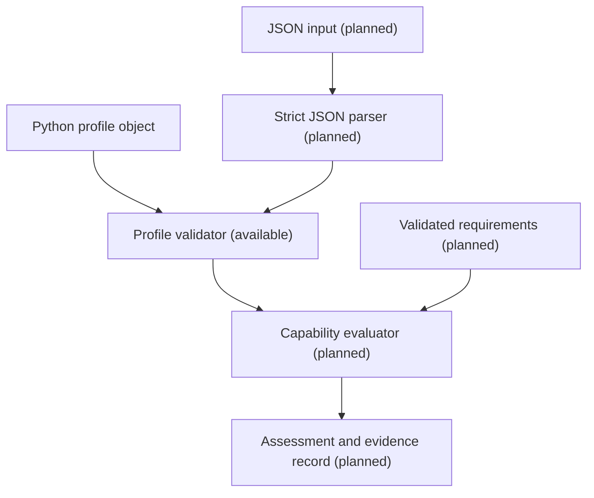

# System Overview

Status: Initial Python profile validation and unit tests are published. JSON ingestion, requirement evaluation and result recording are planned.

## Problem

A device manifest can declare processor architecture, memory and available interfaces. These declarations can guide software decisions, but their format and their truth are separate questions.

SILIARCH starts by validating the format. Requirement matching follows only after both the profile and the requirements have passed their own checks. Hardware identity and integrity need separate evidence.

## Component boundaries

| Component | Input | Responsibility | Status |
|---|---|---|---|
| JSON parser | Raw text or file | Read bounded input and reject ambiguous JSON, including duplicate keys | Planned |
| Profile validator | Python object | Enforce the Device Profile v0.1 contract | Initial implementation |
| Requirement validator | Python object | Enforce the requirement contract before matching | Planned |
| Capability evaluator | Valid profile and valid requirements | Compare declared values and return a deterministic outcome | Planned |
| Result writer | Assessment and execution context | Preserve outcome, reasons and limitations | Planned |
| Hardware adapter | Platform-specific interface | Collect observations under a defined measurement policy | Future research |

A parser does not prove who supplied the input. A validator does not measure hardware. An evaluator must not infer properties that the validated profile does not declare.

## Data flow



The published Python validator works with supplied objects. The JSON-to-object path and every stage after profile validation are still to be implemented.

### Runtime and design dependencies

The files have distinct roles:

- [`DEVICE_PROFILE_V0_1.md`](DEVICE_PROFILE_V0_1.md) states the data contract. It is a design reference, not a runtime dependency.
- [`src/siliarch/profile.py`](../../src/siliarch/profile.py) implements memory and profile checks.
- [`tests/test_profile.py`](../../tests/test_profile.py) imports the Python functions and exercises expected outcomes.
- [`TRUST_AND_EVIDENCE.md`](TRUST_AND_EVIDENCE.md) establishes how reported results may be interpreted.
- [`docs/ROADMAP.md`](../ROADMAP.md) tracks work required to reach an end-to-end prototype.

The test command runs from the repository root:

```bash
PYTHONPATH=src python3 -m unittest discover -s tests -p 'test_*.py' -v
```

The `PYTHONPATH` value adds `src` to Python's module search path. It allows the tests to import `siliarch.profile` without moving the production module into the test directory.

## Profile contract

Device Profile v0.1 contains five fields: `schema_version`, `device_id`, `architecture`, `memory_bytes` and `capabilities`. All are required and unknown fields are rejected. Detailed rules are in the [profile specification](DEVICE_PROFILE_V0_1.md).

A successful validation result establishes only that supplied data follows those rules. It does not show that a device exists or that its description is accurate.

## Example assessment

A fictional profile declares:

- `architecture` = `arm64`
- `memory_bytes` = `65536`
- `capabilities` = `["uart"]`

Suppose a requirement asks for ARM64, at least 32768 bytes of memory and UART. A future evaluator should report a match of **declared values** if both input objects pass validation. It must not report a physical hardware measurement.

Malformed input must produce a validation error rather than a match or no-match result.

## Future hardware work

The longer-term design separates portable software checks from adapters, RTL verification and trust mechanisms. Planned work includes FPGA experiments, embedded firmware and ARM or RISC-V integration. A common processor architecture does not imply common peripherals, firmware or security features.

Physical measurement and cryptographic attestation will require platform-specific methods, trustworthy identities, measurement definitions, freshness checks and verification policies.

## Acceptance conditions

The foundation capability prototype is ready for review when:

1. Input size and JSON parsing rules are enforced.
2. Profile and requirement validation cover documented invalid and boundary cases.
3. Capability outcomes and failure reasons are reproducible.
4. The CLI and tests run through documented commands.
5. Results distinguish declarations from measured or attested properties.

See [Engineering Roadmap](../ROADMAP.md) and [ADR-0001](../decisions/0001-foundation-first.md).
